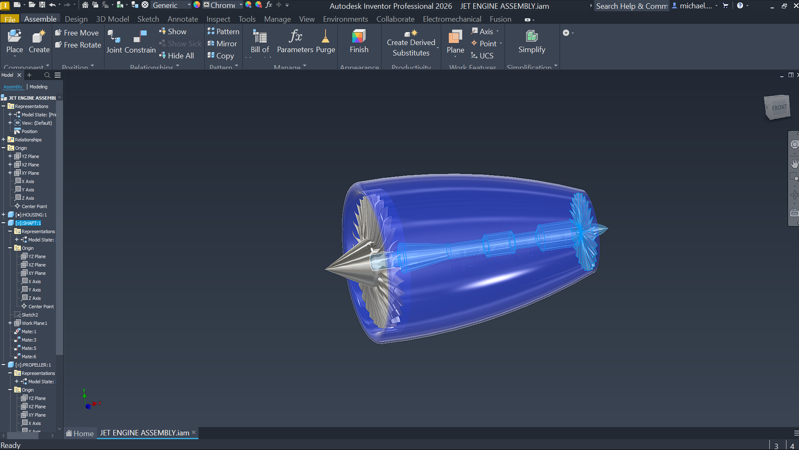

# Jet Engine Nacelle Assembly

## Project Overview
A 3D mechanical CAD assembly of a high-bypass jet engine nacelle and turbine fan section, developed in Autodesk Inventor. This project highlights surface modeling techniques and rotational assembly constraints relevant to aerospace propulsion systems.

## Technical Details
* **Software:** Autodesk Inventor Professional
* **Key Features:**
  * Aerodynamic nacelle housing surface modeling.
  * Internal turbine blade array and spinner cone assembly.
  * Exported as `.STEP` for universal CAD compatibility and `.STL` for native GitHub 3D web viewing.
* **Author:** Michael Muchemi | Aerospace Engineering

## How to View
* **In Browser:** Click on the `.stl` file in the repository to interactively rotate and inspect the 3D turbine model directly in GitHub's 3D viewer.
* **In CAD Software:** Download the `.step` file to open the full assembly in any standard engineering CAD software (SolidWorks, Fusion 360, CATIA, etc.).
